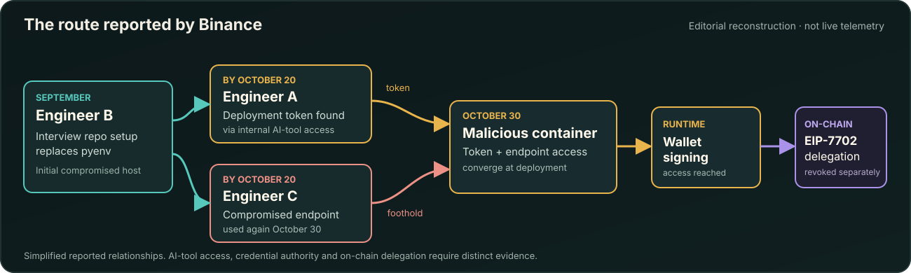
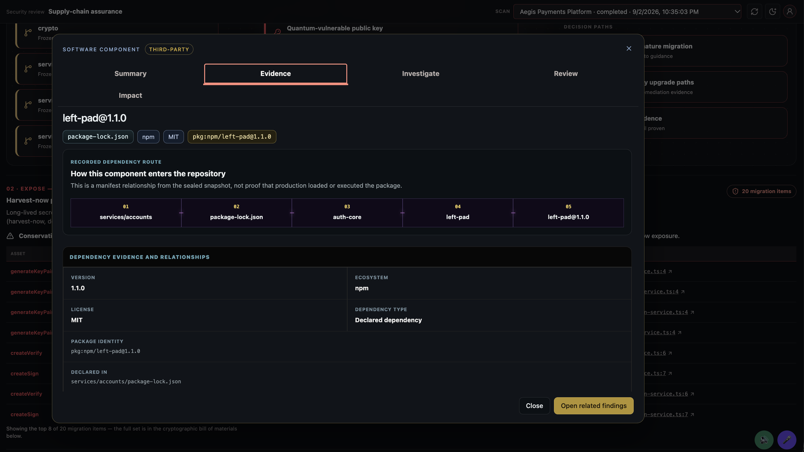
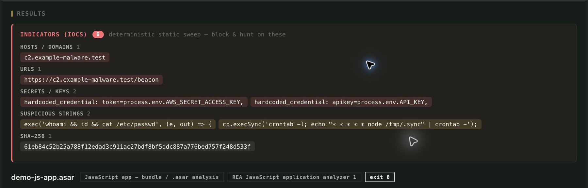
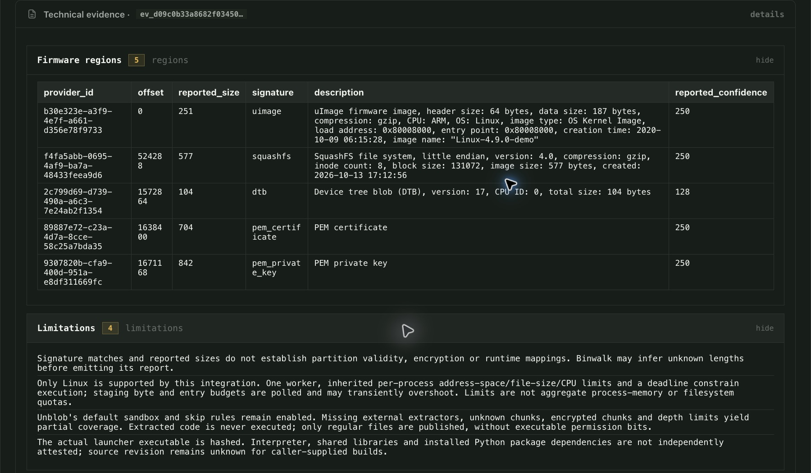
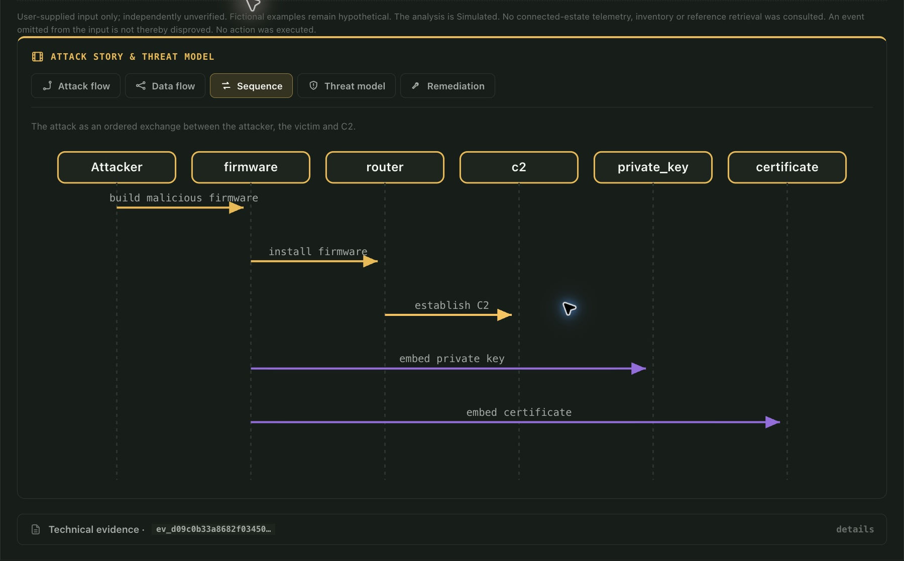
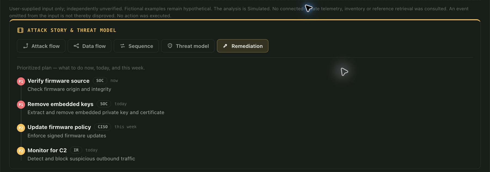

*Binance's preliminary account traces an altered developer tool through an AI-tool pivot and a malicious deployment into wallet-signing access. We use that sequence to examine the evidence and response decisions that Breakwater ASOC can help security teams investigate.*

<!--more-->

In September 2026, a Binance engineer downloaded a repository presented as a job-interview assignment and followed installation instructions that executed malicious code. According to [Binance's preliminary incident report](https://www.binance.com/en/square/post/384314641614134), the code replaced a legitimate 3,344-byte `pyenv` component with a 3,414-byte malicious file and recreated the command's symlink. The command still looked familiar when invoked, and endpoint defenses did not catch the substitution.

By October 20, the attackers had turned Engineer B's compromised workstation into a foothold for reaching two colleagues through internal AI tools (see fig 1 below). One branch led to Engineer A's workstation, which held a token with container-deployment permissions; the other led to Engineer C's workstation, later used to deploy a malicious container into the wallet environment on October 30. Binance says the operation reached its internal wallet-signing service and abused Ethereum's [EIP-7702 authorization mechanism](https://eips.ethereum.org/EIPS/eip-7702).

Engineer A's involvement reached back to June, when a tampered Homebrew installer compromised an earlier workstation. Binance detected that intrusion, replaced the device, and rotated related credentials, although information about A's role and colleagues had already been exposed.

The disclosed chain leaves plenty for defenders to investigate, including the bytes installed on Engineer B's machine, the AI-tool sessions that reached other engineers, the scope of the stolen deployment credential, and the authorizations that remained effective after withdrawals were suspended.

Breakwater's [ASOC platform](https://www.bwtr.ai/) brings together [Provenance](https://www.bwtr.ai/provenance/) for traceable software evidence, [Discover](https://www.bwtr.ai/discover/) for asset relationships and attack paths, and [Response](https://www.bwtr.ai/response/) for artifact analysis and controlled response planning. The examples below come from separate product demonstrations because we have not inspected Binance's internal evidence, analyzed its malware in Breakwater, or executed remediation on its systems.

## The route Binance has disclosed

<figure class="breakwater-figure">
  
  <figcaption>Figure 1. Simplified incident route from Binance's preliminary report. The two engineering endpoints contribute different forms of access to the malicious deployment; the diagram is an editorial reconstruction.</figcaption>
</figure>

To get from a replaced `pyenv` command to the wallet signer, the attackers relied on forms of authority that normally live in different systems. Engineer B's workstation ran the substituted tool, internal AI tooling reached other engineers, and the deployment credential obtained from Engineer A's machine helped place a container using Engineer C's workstation. Suspending withdrawals then left the separate EIP-7702 authorizations to address on-chain.

The records needed to reconstruct those transitions are scattered across endpoint measurements, identity sessions, deployment policy, signer audits, and blockchain state. We'll use Breakwater's product views to examine what a defender could establish from each source, starting with the executable that appeared to be `pyenv`.

## Investigating the software behind a trusted name

At a shell prompt, `pyenv` looks like a routine developer command, although its name offers no guarantee about the bytes the machine will execute, where they came from, or which dependencies were involved.

In its Aegis Payments Platform example, Breakwater Provenance lets a reviewer inspect the source relationships behind a declared dependency. Selecting `left-pad@1.1.0` reveals this recorded route:

`services/accounts → package-lock.json → auth-core → left-pad → left-pad@1.1.0`

<figure class="breakwater-figure">
  
  <figcaption>Figure 2. Provenance traces a transitive dependency to its declaration in the Aegis source snapshot. The view does not establish that the dependency ran in production.</figcaption>
</figure>

The route points the reviewer toward a particular declaration in the source: if `auth-core` continues to request an older `left-pad` version, changing a top-level dependency may leave that nested package in place. With the dependency's recorded origin visible, the engineer has a better basis for deciding which change to test.

Binance's `pyenv` substitution sits closer to the endpoint, where an executable can be replaced even while the project's manifest remains clean. Investigators would compare the digest and symlink target measured on Engineer B's machine with an approved artifact, then trace that approved version to its source and build history. [SLSA's artifact-verification guidance](https://slsa.dev/spec/v1.2/verifying-artifacts) explains how the artifact digest, provenance, and expected build and source relate to one another.

Binance's reported 70-byte discrepancy gave investigators a clue, but file size is a weak integrity test without a trusted reference. Provenance's dependency view illustrates how to establish the expected source relationship; confirming which bytes ran would still require measurements and execution records from the affected workstation.

## What the suspicious artifact can tell us

Because Binance says the replacement software executed commands and contacted attacker-controlled infrastructure, an investigation would examine the file's contents alongside the process and network activity recorded after installation. Evidence inside the file can direct that search, while endpoint telemetry is needed to establish what it did.

The Reverse Engineering Analysis (REA) workflow in Breakwater Response lets an analyst inspect a suspicious file, as illustrated by the built-in `demo-js-app.asar` example. Its scan of an Electron application archive reports shell-command strings, environment-variable references, a scheduled-command indicator, and the demonstration domain `c2.example-malware.test`.

<figure class="breakwater-figure">
  
  <figcaption>Figure 3. Static findings from <code>demo-js-app.asar</code>. The environment-variable references contain no exposed secret values; the displayed indicators are leads for analysis, with no execution or network contact established by this scan.</figcaption>
</figure>

With Binance's actual `pyenv` sample, an analyst would choose an analyzer suited to its format, extract leads, and correlate them with process trees and network records from the compromised workstation. A domain-like string inside a file can direct a search, but without a corresponding connection record it cannot establish that the malware contacted the address. The same endpoint evidence would also help determine which sessions or credentials the attackers obtained before moving beyond Engineer B's machine.

## Following the route out of Engineer B's workstation

In Binance's October 20 account, the attackers used internal AI tools from Engineer B's compromised computer to reach Engineers A and C. A's deployment token and C's later role as the container-deployment endpoint contributed different parts of the operation, which an investigator would have to connect through actual tool calls, identities, privileges, and session records.

Understanding the reach of that token also requires its issuer's permissions and policy records. A map of the endpoint and AI-tool relationships would let the team examine where the attackers could move, which grants of access mattered, and where a control could interrupt the route.

Breakwater Discover's animated **Attack Paths** view offers an example of that map, using a simulated industrial network that begins near an edge router and reaches operational controllers. The viewer can inspect the intermediate assets, services, route conditions, and evidence identifiers along the modeled path.

<figure class="breakwater-figure breakwater-video">
  <video controls playsinline muted preload="metadata" poster="/assets/images/2026/binance-breakwater-asoc/fig-03-discover-poster.jpg" aria-label="Breakwater Discover Attack Paths animation in a simulated industrial environment">
    <source src="/assets/images/2026/binance-breakwater-asoc/fig-03-discover-attack-paths.mp4" type="video/mp4" />
    Your browser does not support embedded MP4 playback.
  </video>
  <figcaption>Figure 4. Breakwater Discover Attack Paths in a simulated industrial environment. The eight-step route and confidence values are modeled, with no Binance assets represented. <a href="/assets/images/2026/binance-breakwater-asoc/fig-03-discover-attack-paths.mp4">Open the MP4 directly</a>.</figcaption>
</figure>

Although the industrial network has different assets from Binance's environment, its route presents a similar analytical problem: tracing how an initial foothold might approach a critical service through intermediate systems. In the Binance case, that would mean drawing the branches from Engineer B's endpoint toward Engineer A's deployment authority and Engineer C's execution environment, then testing each connection against records before concluding how the container was deployed.

Where the animation uses modeled connectivity and confidence values, an actual AI-tool route would need to be checked against tool invocation logs, identity-session records, and deployment policies. That evidence distinguishes a route an attacker could use from one the attacker is known to have traversed.

## Turning fragments into a testable attack story

Binance's public account gives the major milestones without detailing every tool invocation, process, or privilege transition. An investigator working from those milestones would build a provisional sequence and revise it as logs and artifacts either support or challenge the proposed connections.

Breakwater Response's firmware example is a useful exercise in separating observed markers from inferred activity, even though Binance's disclosed path concerned developer tools and cloud workloads. In the built-in `demo-router-firmware.bin` sample, its technical-evidence view records Binwalk 3.1.0 signature matches for a Linux uImage, SquashFS, a device tree, a certificate, and a private-key marker at byte offset 1,671,168. The offset identifies a region worth inspecting, while extraction and actual key use would require further evidence.

<figure class="breakwater-figure">
  
  <figcaption>Figure 5. Firmware-region evidence from <code>demo-router-firmware.bin</code>, including signature offsets and limits of the parser's findings.</figcaption>
</figure>

The **Attack Story & Threat Model** Sequence view takes those findings into a proposed sequence involving an attacker, a router, a possible command-and-control endpoint, and cryptographic material. Its connections provide questions for an analyst to test against acquired artifacts, logs, or controlled analysis.

<figure class="breakwater-figure">
  
  <figcaption>Figure 6. <strong>Hypothetical sequence, generated by Breakwater Response</strong> for the router fixture. The proposed events, their order, and any key use or command-and-control communication require confirmation.</figcaption>
</figure>

Applied to Binance, that method would begin with endpoint execution logs around `pyenv`, continue through the October 20 AI-tool session history and the deployment token's issuance and permissions, and then examine the October 30 container records. Signing-service audit trails and on-chain state would help establish which downstream instructions and authorizations were accepted.

Missing records should remain identified as gaps in the proposed sequence, leaving room to confirm or revise its connections when new evidence arrives.

## Containment must reach the systems that still grant authority

Binance could suspend withdrawals through its ordinary infrastructure, but the malicious EIP-7702 authorizations on-chain still had to be cleared through separate transactions. According to the company, its multi-party computation setup complicated immediate revocation because there was no single private key available to perform it.

Outside cryptocurrency, the same containment problem arises when rebuilding a compromised workstation leaves a deployment token valid at its issuer, or replacing an application leaves an integration session active elsewhere. Until the receiving system rejects the attacker's authority, the team still has to establish that containment took effect.

In Breakwater Response, the **Remediation** view turns findings into proposed work with priorities, owners, and timing. The router firmware example includes both investigation and mitigation tasks, with no executed containment action recorded in the screenshot.

<figure class="breakwater-figure">
  
  <figcaption>Figure 7. Proposed remediation tasks for the firmware fixture, with priorities, owners, and target timing.</figcaption>
</figure>

For a path resembling the one Binance disclosed, the response plan should name both the authority to change and the record that will confirm the change:

| Attack-path component | Investigation or mitigation decision | Evidence to check afterward |
|---|---|---|
| Replaced `pyenv` executable | Restore a trusted artifact and inspect persistence | Approved digest, endpoint measurement, process history |
| AI-tool sessions and engineering endpoints | Close compromised sessions and investigate additional reachability | Identity and tool audit logs, session revocation, follow-up access tests |
| Container-deployment credential | Revoke the exposed token at its issuer and review permitted actions | Issuer state, deployment audit, denied-use check where safe |
| Unauthorized workload and wallet-signing access | Remove malicious deployment and restrict the signing route | Runtime inventory, approved workloads, signing-service audit records |
| EIP-7702 authorization | Clear or replace malicious on-chain delegation through an authorized process | Confirmed transactions and resulting account state |

These checks form an investigative template drawn from Binance's disclosure, with no claim that Breakwater executed them against Binance's systems. On-chain delegation changes would require the appropriate blockchain and signing infrastructure; the broader response goal is to reach every receiving system that may still honor the attacker's permissions.

## Investigating the part of the attack we can see

Binance's preliminary report puts approximately $6.34 billion in digital assets within the incident's scope, with $2.85 billion frozen or blocked during the response. Those figures describe affected assets and intervention results, while the final unrecovered loss may differ. The route itself crossed developer software, internal AI tools, deployment permissions, and wallet signing; the on-chain delegations needed their own response after ordinary withdrawals were suspended.

For a security team facing similar questions, Breakwater ASOC can help trace software relationships in Provenance, examine candidate routes to critical assets in Discover, and use Response to turn artifact findings into testable explanations and mitigation tasks. The examples here show each capability in a representative environment; applying the approach to an actual incident would require the organization's own artifacts, session records, and authority data.

A stolen deployment token can remain dangerous after the malware that captured it has been removed, particularly when it reaches systems that hold authority outside the original workstation. We think security teams should be able to map those downstream relationships before an incident and specify how they will verify revoked access when containment becomes urgent.

**Bring us a critical asset, a suspicious component, or a route your team cannot fully explain.** [Request a Breakwater ASOC demonstration](https://www.bwtr.ai/#evaluation) to see how Discover, Provenance, and Response investigate the exposure and develop a mitigation plan. You can also [scope a focused proof of concept](https://www.bwtr.ai/poc-planner/) around the systems and questions that matter to your team.

### Sources and demonstration notes

- [Binance, preliminary investigation report (November 2026)](https://www.binance.com/en/square/post/384314641614134): reported chronology, software substitution, AI-tool movement, deployment authority, signing-service access, response measures, and asset figures. The investigation is ongoing.
- [EIP-7702 specification](https://eips.ethereum.org/EIPS/eip-7702): account authorization and delegated execution mechanics.
- [SLSA artifact verification](https://slsa.dev/spec/v1.2/verifying-artifacts): guidance on comparing an artifact digest and provenance with the expected build and source.
- [Breakwater Discover](https://www.bwtr.ai/discover/), [Provenance](https://www.bwtr.ai/provenance/), and [Response](https://www.bwtr.ai/response/): product capabilities and evaluation scope. Figure 1 is an editorial map from Binance's account; Figures 2, 3, 5, 6, and 7 use separate product fixtures, and Figure 4 is a simulated Discover recording.
